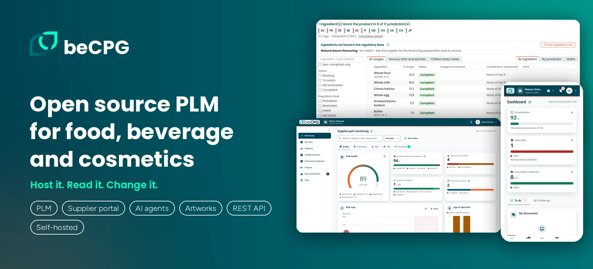

beCPG manages the whole product lifecycle for food, beverage and cosmetics manufacturers:
formulation, nutrition and labelling, specifications, packaging and eco-design, quality,
new product development projects, supplier collaboration and regulatory compliance.
More than 120 manufacturers worldwide use it, as a managed cloud service or self-hosted.

[Website](https://www.becpg.net) · [Documentation](https://www.becpg.net/docs/en/) · [Free trial](https://www.becpg.net/contact-us/#trial) · [Book a demo](https://www.becpg.net/contact-us/#demo)

## Repositories

| Repository | What it is |
| --- | --- |
| [becpg-community](https://github.com/becpg/becpg-community) | The beCPG PLM platform, open source under LGPL v3 |
| [becpg-starter](https://github.com/becpg/becpg-starter) | Let an AI agent work in your PLM |
| [becpg-supplier-portal](https://github.com/becpg/becpg-supplier-portal) | Collect specifications, certificates and questionnaires from your suppliers |
| [becpg-artworks](https://github.com/becpg/becpg-artworks) | Annotate, compare and sign artworks and documents |
| [becpg-java-rest-api](https://github.com/becpg/becpg-java-rest-api) | Java SDK for the beCPG REST API |
| [becpg-transform-markdown](https://github.com/becpg/becpg-transform-markdown) | Convert documents to Markdown for AI assistants |
| [becpg-i18n](https://github.com/becpg/becpg-i18n) | Translation files |

## Contribute

Read the [contributing guide](https://github.com/becpg/.github/blob/main/CONTRIBUTING.md) and report
security issues as described in the [security policy](https://github.com/becpg/.github/blob/main/SECURITY.md).
